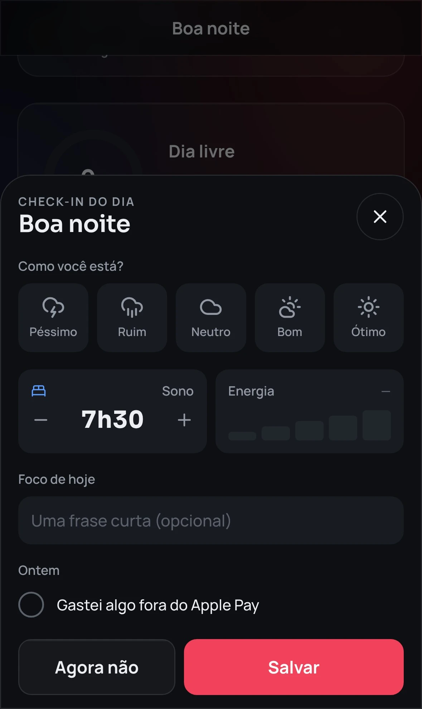
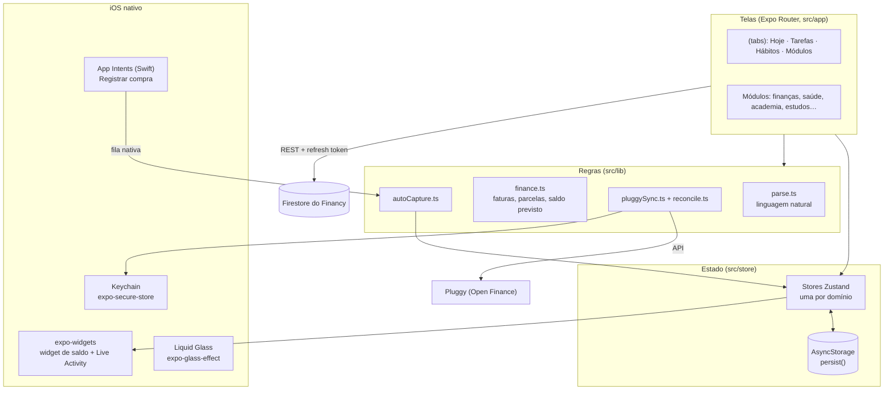

<div align="center">

# Órbita

**App de organização pessoal para iPhone, com módulos que ligam e desligam, captura de tarefas em linguagem natural e o visual Liquid Glass do iOS 26.**

[](https://github.com/GabrielPMachado/Orbita/actions/workflows/ci.yml)
[](https://github.com/GabrielPMachado/Orbita/actions/workflows/build-ios.yml)


-F05138?style=flat-square&logo=swift&logoColor=white)


[Arquitetura](#arquitetura) · [Como rodar](#como-rodar) · [Funcionalidades](#funcionalidades) · [English](#english)

</div>

<p align="center">
  
  <br />
  <sub>O Órbita numa tela de iPhone: check-in do dia, tarefa criada em linguagem natural e hábitos. Gravado da versão web do app (Expo).</sub>
</p>

## Sumário

- [Sobre](#sobre)
- [Destaques](#destaques)
- [Arquitetura](#arquitetura)
- [Stack](#stack)
- [Estrutura de pastas](#estrutura-de-pastas)
- [Como rodar](#como-rodar)
- [Qualidade e CI](#qualidade-e-ci)
- [Decisões técnicas](#decisões-técnicas)
- [Design](#design)
- [Funcionalidades](#funcionalidades)
- [Módulos](#módulos)
- [Roadmap](#roadmap)
- [Licença](#licença)
- [English](#english)

## Sobre

O Órbita junta tarefas, hábitos, finanças, saúde, estudos e mais em um só app, e cada área é um **módulo** que pode ser ligado ou desligado. Os dados ficam no próprio aparelho. Foi inspirado no Nexo e feito do zero, com o visual Liquid Glass nativo do iOS 26.

## Destaques

- **Captura rápida em linguagem natural:** "pagar boleto amanhã 15h #casa !alta" vira tarefa com data, hora, tag e prioridade
- **Finanças completas:** contas, cartões com fatura, parcelas, orçamentos e simulador freelancer
- **Compras do Apple Pay entram sozinhas** por uma ação do app Atalhos escrita em Swift
- **Conferência com o banco** via Open Finance (Meu Pluggy), com selo de verificado
- **Widget de saldo** na tela de bloqueio e **Live Activity** do modo foco na Dynamic Island
- **Integração com o [Financy](https://github.com/GabrielPMachado/Financy):** saldo, aparência e categorias do Apple Pay compartilhados
- Animações com mola, gestos de deslizar e respeito ao **Reduzir movimento** do iOS

## Arquitetura



Cada domínio (tarefas, hábitos, finanças, lembretes…) tem a sua store Zustand com `persist`, salva no AsyncStorage. As regras de negócio ficam em funções puras em `src/lib`, separadas das telas. O que exige iOS nativo (ação do Atalhos, widgets, Live Activity, Keychain, Liquid Glass) entra por módulos do Expo, sem ejetar o projeto.

## Stack

| Camada | Tecnologias |
| --- | --- |
| App | Expo SDK 58, React Native 0.88, React 19, TypeScript, Expo Router |
| Estado | Zustand 5 + AsyncStorage |
| Interface | `expo-glass-effect` (Liquid Glass), `expo-blur`, Reanimated 4, Gesture Handler 3, `react-native-svg`, Lucide, fontes Sora e Manrope |
| Nativo | `expo-app-intents` (Swift), `expo-widgets`, `expo-notifications`, `expo-secure-store`, `expo-alternate-app-icons`, `expo-keep-awake` |
| Integrações | Pluggy / Meu Pluggy (Open Finance), Firestore REST (Financy), RSS |
| Build | GitHub Actions em macOS gerando um .ipa sem assinatura para o Sideloadly |

## Estrutura de pastas

```
.
├── .github/workflows/
│   ├── ci.yml             # tipos e build web em todo push e PR
│   └── build-ios.yml      # gera o .ipa num Mac do GitHub
├── app-intents/           # ação "Registrar compra" do app Atalhos (Swift)
├── assets/                # ícones, splash e fontes
├── docs/                  # animação do README
├── src/
│   ├── app/               # telas (cada arquivo = uma rota)
│   │   ├── (tabs)/        # Hoje, Tarefas (kanban), Hábitos, Módulos
│   │   ├── financas/      # visão geral, novo, contas, cartões, orçamentos, simulador, Pluggy…
│   │   ├── notas/  trabalho/  clientes/  invoices/  academia/  financy/
│   │   └── lembretes.tsx  metas.tsx  foco.tsx  configuracoes.tsx  em-breve/[id].tsx …
│   ├── components/        # UI (ui.tsx), Glass, TabBar, captura rápida, motion…
│   ├── lib/               # parse, finanças, Pluggy, conciliação, foco, notificações, Financy
│   ├── store/             # stores Zustand persistidas
│   ├── widgets/           # SaldoWidget e FocoActivity
│   ├── modules.ts         # registro dos módulos (seções, ícones, prontos ou não)
│   └── theme.ts           # cores, espaçamentos, raios e tipografia
└── app.json               # nome, ícone, bundle id e plugins
```

## Como rodar

### Pré-requisitos

- Node.js 22.13+
- Um iPhone com o **Expo Go** (desenvolvimento) ou o **Sideloadly** no computador (app instalado)

### Desenvolvimento no iPhone (Expo Go, sem compilar)

```bash
git clone https://github.com/GabrielPMachado/Orbita.git
cd Orbita
npm install
npx expo start
```

No iPhone, abra o **Expo Go** e aponte a câmera para o QR code. Computador e celular precisam estar na mesma rede Wi-Fi (se não conectar, use `npx expo start --tunnel`). Toda alteração no código aparece no celular na hora.

> Widget, Live Activity e a ação do Atalhos só existem no app instalado (.ipa). No Expo Go e na versão web eles não aparecem; o resto funciona.

### Gerar o .ipa e instalar com o Sideloadly

Compilar para iOS exige um Mac. Este projeto usa um **Mac grátis do GitHub Actions**:

1. Na aba **Actions** → **Build iOS (.ipa para Sideloadly)** → **Run workflow**. Ele também roda sozinho a cada push na `main` e demora uns 15 a 25 min.
2. Quando terminar, baixe o artefato **Orbita-ipa** (vem num .zip; extraia o `Orbita.ipa`).
3. No **Sideloadly**, conecte o iPhone no cabo, arraste o `Orbita.ipa`, coloque seu Apple ID e clique em **Start**.
4. No iPhone: **Ajustes → Geral → VPN e Gerenciamento de Dispositivos** → confie no seu Apple ID. No iOS 16+ também é preciso ligar o **Modo de Desenvolvedor** (Ajustes → Privacidade e Segurança).

**Limites com Apple ID gratuito:** o app expira em 7 dias (é só reinstalar; os dados ficam) e no máximo 3 apps instalados assim. Com a conta Apple Developer paga, dura 1 ano. Como o .ipa tem uma extensão (o widget), cada instalação usa mais App IDs (limite de 10 por semana na conta grátis). Se o widget não mostrar o saldo, o App Group não foi aceito pela conta grátis; o app em si continua funcionando.

### Scripts

| Comando | O que faz |
| --- | --- |
| `npm start` | Abre o Metro Bundler (`expo start`) |
| `npm run ios` | Abre no simulador do iOS (requer Mac) |
| `npm run web` | Roda a versão web, com dados de exemplo |
| `npx tsc --noEmit` | Checagem de tipos |

## Qualidade e CI

| Workflow | Quando roda | O que faz |
| --- | --- | --- |
| [`ci.yml`](.github/workflows/ci.yml) | Todo push na `main` e todo pull request | `npm ci`, checagem de tipos e build web (`expo export`) |
| [`build-ios.yml`](.github/workflows/build-ios.yml) | Push na `main` e sob demanda | Compila o .ipa num Mac do GitHub |

## Decisões técnicas

- **Dados no aparelho, sem conta.** Zustand + AsyncStorage deixam o app instantâneo e funcionando offline. O `storage` fica num único arquivo (`src/lib/storage.ts`), então trocar por sync na nuvem não mexe nas telas.
- **Módulos como registro.** `src/modules.ts` lista todos os módulos com seção, ícone e se estão prontos. Ligar, desligar ou criar um módulo não exige mexer na navegação.
- **Parser próprio de linguagem natural.** `src/lib/parse.ts` entende datas relativas, dias da semana, tags e prioridades em português, sem depender de uma API externa.
- **Nativo sem ejetar.** App Intents em Swift, widgets e Live Activity entram por módulos do Expo e pelo build no GitHub Actions; o projeto continua 100% Expo.
- **Segredos no Keychain.** As credenciais da Pluggy e a chave do Financy ficam no `expo-secure-store`, só neste aparelho; nenhuma senha de banco passa pelo app.
- **Financy por REST.** Em vez de incluir o SDK do Firebase, o Órbita fala com o Firestore do Financy pela API REST com um refresh token, o que mantém o app leve.
- **Build de iOS sem Mac.** Um runner macOS do GitHub gera um .ipa sem assinatura, que o Sideloadly assina com o Apple ID do usuário.

## Design

- **Direção:** calmo, preciso, noturno. Grafite profundo, um único acento, vidro só no que flutua.
- **Vidro:** `src/components/Glass.tsx` usa **Liquid Glass nativo** (`expo-glass-effect`) no iOS 26+ em praticamente tudo: tab bar (agrupada com `GlassContainer`), botões, cards, listas, campos, chips, controles segmentados, teclado de valor, seletor de humor, módulos e sheets. Um fundo ambiente (`Ambient`) dá cor para o vidro refratar. Sem Liquid Glass, o que flutua usa desfoque (`expo-blur`) e o resto um vidro translúcido leve.
- **Ícones:** só SVG (Lucide), mesmo traço em tudo. Humor usa ícones de clima; hábitos têm 20 ícones para escolher.
- **Tipografia:** Sora (títulos) + Manrope (texto), números tabulares em valores.
- **Tokens:** cores, espaços (4/8), raios e escala de texto em `src/theme.ts`.

<details>
<summary><b>Movimento e gestos</b></summary>

`src/components/motion.tsx` (Reanimated 4 + Gesture Handler 3). Tudo respeita **Reduzir movimento** do iOS.

- **Entrada em cascata** dos blocos de cada tela e **listas animadas** (itens entram, saem e se reorganizam com mola).
- **Título grande que some** ao rolar e dá lugar a uma **barra compacta de vidro**; fundo ambiente com parallax; puxar para atualizar (Notícias).
- **Toque com mola** em cards, botões, chips e botões de vidro; **checkbox** que pula; **indicador deslizante** no controle segmentado e na tab bar (ícone pula ao trocar de aba).
- **Anéis e barras de progresso** animados; **números que contam** (saldo, %, metas); **gráficos que crescem**.
- **Deslizar linhas**: tarefas (→ concluir, ← excluir), lançamentos (→ pago/pendente, ← excluir), lembretes. Exclusões com **Desfazer** no aviso.
- **Sheets**: arraste a alça/título para baixo para fechar.
- **Confete** ao completar o dia, ao bater meta, ao fechar um foco e em marcos de sequência (7, 14, 21, 30, 50, 100, 365 dias).
- **Skeleton** enquanto as notícias carregam; chips da captura rápida "pulam" para dentro enquanto você digita.

</details>

<details>
<summary><b>Aparência</b></summary>

- **Configurações › Aparência:** cores prontas (as mesmas do Financy) e suas próprias (+). Tocar numa cor abre a **roda de intensidade** (0–11), que pinta o fundo do app; no 11 tudo acende.
- **Ícones:** estilo (suave, sólido, contorno, só ícone) e cor (coloridos, destaque, neutros).
- Com o Financy conectado, cor, roda e ícones ficam iguais nos dois apps (`aparencia/compartilhada`); quem mudou por último vale.

</details>

## Funcionalidades

<details>
<summary><b>Captura rápida (linguagem natural)</b></summary>

| Você escreve | O app entende |
|---|---|
| `amanhã 15h` / `hoje 18h30` / `às 7` | data + hora |
| `sexta` / `segunda-feira` | próximo dia da semana |
| `dia 20` / `05/12` / `em 3 dias` / `em 2 semanas` | data |
| `#trabalho` | tag |
| `!alta` `!media` `!baixa` (ou `!1 !2 !3`, `urgente`) | prioridade |

</details>

<details>
<summary><b>Finanças</b></summary>

- **Contas** com saldo inicial → saldo atual calculado sozinho (só o que está pago/recebido).
- **Cartões** com dia de fechamento e vencimento: cada compra cai na fatura certa; limite usado e disponível.
- **Parcelas** no cartão (até 24x) e **lançamentos fixos** (repetir N meses). Os meses futuros nascem pendentes.
- **Saldo previsto** no fim de cada mês (cartão pesa no mês da fatura).
- **Orçamentos** por categoria, gráfico dos últimos 6 meses, gastos por categoria.
- **Novo lançamento** em 4 passos com teclado de valor estilo banco e comprovante em foto.
- **Simulador freela** (por hora ou projeto, taxa, imposto, custos) com cópia formatada para o WhatsApp e botão para lançar como entrada.

**Fotos** (câmera ou galeria) em notas, comprovantes de lançamentos e foto de perfil. Ficam salvas dentro do app (`Documents/media`); só o nome do arquivo vai para os dados.

</details>

<details>
<summary><b>Lançamentos automáticos (Apple Pay)</b></summary>

Cada compra feita com o iPhone entra sozinha, sem abrir o app. Você só escolhe a categoria.

- `app-intents/RegistrarCompraIntent.swift` cria a ação **Registrar compra** no app Atalhos (via `expo-app-intents`). Ela roda escondida (`openAppWhenRun = false`) e pergunta a categoria quando a automação não informa.
- A compra fica numa fila nativa e vira lançamento quando o Órbita é aberto (`src/lib/autoCapture.ts`). Valor, comerciante e cartão vêm da transação da Carteira; o nome do cartão é casado com os cartões/contas cadastrados.
- Passo a passo dentro do app: **Finanças → Lançamentos automáticos**.
- Só funciona no app instalado (.ipa). No Expo Go a ação não existe.

</details>

<details>
<summary><b>Conferência com o banco (Meu Pluggy)</b></summary>

Configurar: **Finanças → Conferência com o banco** (ou Configurações → Integrações → Meu Pluggy).

1. Em meu.pluggy.ai, conecte seus bancos e cartões (Open Finance, autorizado no app do banco).
2. No Pluggy Dashboard, crie uma aplicação; em **Demo → Connect Account** escolha **MeuPluggy**.
3. Copie **Client ID**, **Client Secret** e o **Item ID** de cada conexão e cole no Órbita.
4. Toque em cada conta do banco para vincular a uma conta/cartão do Órbita (ele tenta adivinhar pelo nome).

Como funciona:

- Baixa o extrato dos últimos 45 dias (`src/lib/pluggySync.ts`), sozinho ao abrir o app no máximo a cada 6 h, ou puxando a tela para baixo.
- O que bater (valor igual, data até 3 dias, mesmo cartão/conta) ganha o **selo de verificado** automaticamente (`src/lib/reconcile.ts`).
- **No banco**: o que só existe no extrato (cartão físico, Pix, débito automático). Toque para importar; a categoria já vem sugerida pelo seu histórico ou por palavras-chave (iFood → Alimentação, Uber → Transporte…). Deslize para ignorar.
- **No app**: lançamentos de contas vinculadas que não apareceram no extrato depois de 2 dias. Corrija ou marque como certo.
- O Client ID e o Client Secret ficam no **Keychain** do iPhone (`expo-secure-store`, só neste aparelho). Nenhuma senha de banco passa pelo app.

</details>

<details>
<summary><b>Widget de saldo (tela de bloqueio)</b></summary>

`src/widgets/SaldoWidget.tsx` (expo-widgets): retangular, circular e em linha na tela de bloqueio, e pequeno/médio na tela inicial. Mostra o saldo atual e o resultado do mês; atualiza a cada lançamento (`src/lib/nativeWidgets.ts`). Em **Configurações → Widget de saldo** dá para esconder os valores (R$ •••••).

Adicionar: na tela de bloqueio, toque e segure → **Personalizar** → **Tela Bloqueada** → área de widgets → **Órbita**.

</details>

<details>
<summary><b>Modo foco (Pomodoro)</b></summary>

- **Hoje → foco** (ou Produtividade → Modo foco) abre a tela cheia: anel que anda sozinho, brilho que "respira" no ritmo 4 s/4 s, tela sempre acesa (`expo-keep-awake`).
- **Emendar ciclos**: foco → pausa → foco sem tocar. A cada 4 focos vem a pausa longa.
- **Live Activity** (`src/widgets/FocoActivity.tsx`): a contagem aparece na tela de bloqueio e na Dynamic Island, contada pelo próprio iOS (fica certa mesmo com o app fechado).
- O motor fica em `src/lib/focus.ts` e é o mesmo para as duas telas.

</details>

<details>
<summary><b>Financy (app de finanças completo)</b></summary>

- **Ver completo no Financy** (Finanças e Hoje) abre o app nativo do Financy (`financy://`) ou, sem ele, o site.
- **Conectar:** no Financy, *Ajustes › Órbita › Copiar chave*; no Órbita, *Configurações › Financy* → colar. A chave fica no Keychain.
- Conectado, o Órbita mostra o saldo e o mês do Financy e o widget da tela de bloqueio pode usar o saldo dele.
- Cada compra do Apple Pay manda a categoria escolhida para o Financy (`comprasApplePay`). Quando a compra chega pelo Open Finance, o Financy aplica a categoria nela, sem lançar em dobro. Sem internet, fica numa fila e vai depois.
- No Financy, o botão de órbita no topo abre o Órbita (`orbita://`).

</details>

<details>
<summary><b>Criar um módulo novo</b></summary>

1. Crie `src/app/<id>.tsx` (copie `metas.tsx` como base: `<Screen back title=…>`).
2. Se precisar guardar dados, crie a store em `src/store/` com `persist(..., { name: '<id>', storage })`.
3. Em `src/modules.ts`, mude `ready: true` no módulo.

</details>

<details>
<summary><b>Prévia web</b></summary>

A versão web roda o app com dados de exemplo. O Liquid Glass é exclusivo do iOS 26+; na web o vidro aparece como desfoque/translúcido.

</details>

## Módulos

| Módulo | O que faz |
|---|---|
| Trabalho | Projetos e subprojetos com tarefas (aparecem também no Kanban), progresso, cliente |
| Clientes | Contatos com WhatsApp/ligar/e-mail, projetos e cobranças de cada um |
| Invoices | Cobranças com itens, vencimento, status (atrasada automático), mensagem pronta pro WhatsApp; marcar como paga lança a entrada em Finanças |
| Saúde | Água (meta + toques rápidos), sono da semana, peso com gráfico, remédios com lembrete diário e estoque |
| Academia | Fichas A/B/C (com modelos), cargas, modo treino com cronômetro, histórico e volume |
| Estudos | Matérias, provas/entregas com contagem regressiva, notas com média ponderada, tempo de estudo |
| Filmes e Séries | Quero ver / assistindo / vistos, temporada e episódio, nota, plataforma, capa |
| Notícias | RSS de g1, Folha, Tecnoblog, Canaltech, InfoMoney (+ adicionar feed), salvar para depois |
| Revisão | Resumo da semana (tarefas, hábitos, humor, foco, treinos, dinheiro) + reflexão |
| Produtividade | Pomodoro com ciclos, modo foco em tela cheia, Live Activity, notificação ao terminar, meta diária |
| Analytics | 7/30/90 dias: tarefas, humor, foco, constância dos hábitos, gastos por categoria |
| Arquivos | Itens arquivados (restaurar/excluir) e galeria de todas as fotos do app |

## Roadmap

- [x] Base: tema, módulos liga/desliga, launcher, Home
- [x] Kanban, Hábitos, Lembretes, Metas, Notas, Finanças
- [x] Finanças completo (contas, cartões, parcelas, orçamentos, simulador) e fotos
- [x] Trabalho, Saúde, Academia, Estudos, Filmes e Séries, Notícias
- [x] Clientes, Invoices
- [x] Revisão semanal, Produtividade (Pomodoro), Analytics, Arquivos
- [x] Lançamentos automáticos via Apple Pay + Atalhos
- [x] Conferência com o banco via Meu Pluggy (Open Finance)
- [x] Widget de saldo na tela de bloqueio
- [x] Modo foco com Live Activity
- [ ] Login + sync na nuvem (Firebase ou Supabase)

## Licença

Projeto pessoal de [Gabriel Pinto Machado](https://github.com/GabrielPMachado). O arquivo [LICENSE](LICENSE) é a licença MIT do template inicial do Expo, de onde o projeto partiu.

---

## English

<details open>
<summary><b>Órbita: personal organization app for iPhone</b></summary>

### About

Órbita brings tasks, habits, finances, health, studies and more into a single iPhone app. Every area is a **module** you can turn on or off, data stays on the device, and the interface uses iOS 26's native Liquid Glass.

### Highlights

- Natural-language quick capture ("pay bill tomorrow 3pm #home !high" in Portuguese)
- Full personal finance: accounts, credit card statements, installments, budgets, freelance simulator
- Apple Pay purchases logged automatically through a Swift App Intent for Shortcuts
- Bank reconciliation via Open Finance (Meu Pluggy)
- Lock Screen balance widget and a Focus-mode Live Activity on the Dynamic Island
- Integration with [Financy](https://github.com/GabrielPMachado/Financy)

### Architecture

Expo Router screens on top of per-domain Zustand stores persisted to AsyncStorage, with business rules as pure functions in `src/lib`. Native iOS features (App Intents, widgets, Live Activity, Keychain, Liquid Glass) come in through Expo modules, so the project stays fully managed. See the [diagram above](#arquitetura).

### Getting started

```bash
git clone https://github.com/GabrielPMachado/Orbita.git
cd Orbita
npm install
npx expo start   # scan the QR code with Expo Go on the iPhone
```

To install the full app, run the **Build iOS** workflow in the Actions tab, download the **Orbita-ipa** artifact and sideload it with Sideloadly.

### CI

`ci.yml` type-checks and exports the web build on every push and pull request; `build-ios.yml` compiles an unsigned .ipa on a GitHub macOS runner.

### Key decisions

- Local-first storage with a single swappable storage adapter
- Module registry instead of hard-coded navigation
- Custom Portuguese natural-language parser, no external API
- Secrets in the iOS Keychain; Financy accessed through Firestore's REST API to keep the app light

### License

Personal project by [Gabriel Pinto Machado](https://github.com/GabrielPMachado). The [LICENSE](LICENSE) file is the MIT license from the original Expo template.

</details>
